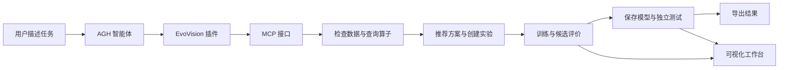

# EvoVision

**通过自然语言组织视觉实验，查看真实训练进度，并保存可追溯的模型与结果。**

EvoVision 是一个基于 Agnes Harness（AGH）的计算机视觉实验工作台。用户提供数据集位置和任务需求，智能体通过插件调用本地引擎，完成数据检查、已有算子查询、方案推荐、实验创建、训练、测试和结果导出。

项目支持图像分类、目标检测和语义分割，提供独立网页、命令行和 MCP 接口。当前版本为 **0.1.0，处于原型阶段**，主要在 Windows + Conda 环境开发和验证。

## 发布计划与演示视频

**当前仓库先公开项目 README、Apache-2.0 许可证及演示视频。完整代码将在作品提交截止后开源。**

- [观看或下载演示视频：EvoVision.mp4](https://github.com/TansyZenix/EvoVision/blob/main/EvoVision.mp4)
- [直接下载视频](https://raw.githubusercontent.com/TansyZenix/EvoVision/main/EvoVision.mp4)

下面的安装命令、目录和功能说明用于介绍完整项目。当前公开仓库尚不包含源码、配置及辅助脚本，待完整代码发布后即可按说明安装运行；相关文档也将在届时一并公开。

## 项目功能

- **自然语言交互**：用普通中文描述任务，在 AGH 中查看工具调用与实验链接。
- **数据检查**：识别支持的数据格式，检查标签、数据划分和跨划分重复图像，记录数据摘要与文件哈希。
- **已有方法推荐**：结合训练数据统计和设备条件推荐模型、预处理、增强与训练配置。插件要求先查询算子库，再核对推荐方案的名称、参数与任务兼容性。
- **统一实验引擎**：分类、检测和分割共用配置、候选管线、评价、约束和存储机制。
- **候选搜索**：使用 Beam Search，在配置允许的模型和参数空间内比较候选，以验证集结果选择模型。
- **可视化工作台**：查看实际生效配置、训练曲线、候选结果、预测预览和运行状态。
- **模型与结果交付**：保存模型、实验记录和独立测试结论，支持模型重载、结果导出及 Pet 图片分割。
- **运行控制**：查询、暂停、恢复、取消实验，以及修改后续候选的参数。

算子已注册、接口兼容与模型精度经过验证是不同层次的能力。具体可用方法以当前运行实例返回的算子库为准。

## 工作流程



模型在训练集上拟合，验证集用于候选选择，测试集用于最终评价。每个实验拥有独立的 `run_id`，实际执行配置保存在 `effective_config.json` 中。

## 技术栈

| 部分 | 实现 |
|---|---|
| 视觉引擎 | Python、NumPy、Pillow、OpenCV、scikit-learn、scikit-image |
| 深度学习 | PyTorch、torchvision、Ultralytics（可选依赖） |
| 梯度提升分类头 | XGBoost、LightGBM（可选依赖） |
| 配置与校验 | YAML、Pydantic |
| 实验存储 | SQLite、JSON、本地模型与图片文件 |
| 智能体接入 | AGH 插件、JSON-RPC stdio MCP |
| 本地工作台 | HTML、JavaScript、Python Web 服务 |

## 环境要求

- Python **3.9 或以上**；项目默认使用 Conda 环境 `pytorchEnv`。
- 深度训练建议使用支持 CUDA 的 NVIDIA GPU；也可使用 CPU，完整训练耗时会更长。
- 使用 AGH 聊天入口时，还需要单独准备 AGH、Node.js **24.10 或以上**，以及 AGH 指定的 pnpm 和构建工具。
- 数据集由使用者自行准备；仓库默认不包含数据、模型权重、历史实验或 API 凭据。

仅使用 EvoVision 命令行和独立工作台时，不需要启动 AGH。

## 安装

下载或克隆本仓库后，在 **包含 `pyproject.toml` 的项目根目录**打开 PowerShell。

没有对应 Conda 环境时，可先创建；已有环境直接激活：

```powershell
conda create -n pytorchEnv python=3.10 -y
conda activate pytorchEnv
$env:PYTHONUTF8 = '1'
$env:PYTHONIOENCODING = 'utf-8'
```

安装基础功能：

```powershell
python -m pip install -e .
```

需要深度模型时：

```powershell
python -m pip install -e ".[deep]"
```

同时需要 XGBoost、LightGBM 等分类头时：

```powershell
python -m pip install -e ".[deep,boosting]"
```

GPU 训练需要与驱动匹配的 PyTorch CUDA 构建。安装后检查：

```powershell
python -c "import torch; print('PyTorch:', torch.__version__); print('CUDA available:', torch.cuda.is_available())"
python -m evovision --help
```

## 快速开始：独立工作台

在项目根目录运行：

```powershell
./scripts/start.ps1
```

访问 [http://127.0.0.1:8765/](http://127.0.0.1:8765/)，保持终端打开。

启动脚本自动激活 `pytorchEnv`。如果已经激活其他项目环境，也可以直接运行：

```powershell
python -m evovision serve --port 8765
```

第一次启动没有历史实验是正常现象，需要先创建实验。可以在网页中新建任务，也可以使用下方 CLI 示例。

## 一个数据集走完全流程：Pet 宠物分割

### 1. 准备数据

将 Oxford-IIIT Pet 数据集整理到自己的目录，例如：

```text
D:/datasets/pet/
├── images/
│   └── 宠物图片.jpg
└── annotations/
    ├── trimaps/
    │   └── 对应标注.png
    ├── trainval.txt
    └── test.txt
```

支持的具体布局见 数据适配实现（evovision/data.py，随完整代码发布）。推荐保留官方 `trainval.txt` 和 `test.txt`，使官方测试划分能够被识别。示例使用二类分割：背景为一类，宠物和边界合并为前景。

### 2. 编写配置

在项目根目录保存 UTF-8 编码的 `pet.yaml`，将数据路径改为真实目录：

```yaml
project:
  name: pet-segmentation
  seed: 42

task:
  type: segmentation
  goal: accuracy

dataset:
  path: D:/datasets/pet
  adapter: oxford_pet
  mode: binary
```

这份配置使用正常数据规模，不设置小样本上限。创建阶段会根据数据和目标补充推荐参数；模型、轮次与预算以返回的实际配置为准，不等同于后面的历史基准设置。

### 3. 创建并开始训练

```powershell
python -m evovision create --config pet.yaml
```

输出包含真实 `run_id`。复制该编号，例如将下方占位文字替换后执行：

```powershell
$runId = '这里填写创建返回的run_id'
python -m evovision start $runId
python -m evovision status $runId
```

在工作台打开对应实验：`http://127.0.0.1:8765/?run_id=你的实验编号`。查看配置、轮次和曲线。启动成功表示后台任务开始执行，训练结束以实际状态为准。

### 4. 查看结果并导出

等待实验显示 `completed` 后执行：

```powershell
python -m evovision status $runId
python -m evovision best $runId
python -m evovision export $runId
```

核对独立测试结果与保存模型路径，导出文件位置以命令返回值为准。完成状态不自动表示达到了某个业务精度目标。

### 5. 使用保存模型处理图片

对已完成且保存了模型的 Pet 二类分割实验执行：

```powershell
python -X utf8 scripts/pet_predict.py --run-id $runId --image "D:/datasets/example.jpg" --output-prefix artifacts/my_pet_prediction
```

生成分割 mask、叠加图、透明背景前景和结果 JSON。图片无需提供真实 mask；没有标注时，这次推理不会产生该图片的 IoU 或 Dice。

## 接入 AGH 聊天

### 准备宿主

默认启动脚本使用下面的目录关系：

```text
workspace/
├── EvoVision/
└── agnes-harness/
```

按照 AGH 仓库的 `docs/guide/install.zh-CN.md` 安装依赖和构建本地 CLI。当前项目使用的宿主构建方式为：

```powershell
# 在 agnes-harness 根目录执行
pnpm install --frozen-lockfile
& ./.github/scripts/prepare-windows-native.ps1 -CacheRoot "$env:LOCALAPPDATA/node-gyp/Cache"
pnpm --filter @agnes/cli build:local
```

AGH 的安装要求以所使用版本的说明为准。随后回到 EvoVision 根目录，在另一个终端启动：

```powershell
./scripts/start-agh.ps1
```

访问 [AGH 聊天页面](http://127.0.0.1:4177/)。宿主路径或 Node 路径不同，可显式指定：

```powershell
./scripts/start-agh.ps1 -AghCli "D:/workspace/agnes-harness/packages/cli/dist/local/agnes.mjs" -NodeExecutable "C:/Program Files/nodejs/node.exe"
```

### 安装插件

1. 在 AGH 设置的插件管理中，从本项目 `agh-plugin` 目录安装插件。
2. 检查包来源和内容摘要，按宿主流程启用。
3. 确认插件运行，并能发现 `evovision_control` 工具和 `evovision-workflow` 工作流。
4. 在 AGH 中配置自己的模型供应方与凭据，新建项目会话。

插件会连接本地 stdio MCP 后端，无需再重复添加同一后端。API 凭据由 AGH 管理，不填写到源码或 YAML 配置中。

### 新手输入示例

先发送：

> 我的宠物图片数据在 D:/datasets/pet。我想把图片里的宠物和背景分开，但我不会训练模型。请先检查数据，再看看 EvoVision 已有哪些可用的方法，从中推荐适合我的方案，用简单的话解释。先不要开始训练。

检查和推荐成功后发送：

> 就按你推荐的方案，用这个数据集正常训练。请创建一个新实验并开始训练，把查看进度的网页链接发给我。

训练结束后发送：

> 请查看刚才这个实验的最终结果，解释测试表现，并导出模型和实验报告，告诉我保存在哪里。

在轨迹中核对实际的算子查询、数据检查、创建与启动记录。模型的文字回复不能代替工具执行结果。

### 更新插件

AGH 使用已安装的插件副本。**修改源码后，仅重启服务不会自动更新这个副本。** 在宿主的插件管理中从源码更新并确认新版本运行；项目也提供 更新脚本（scripts/update-agh-plugin.mjs，随完整代码发布），其依赖同级 AGH 源码及支持 TypeScript 加载的 Node 环境。

本机 AGH 前端另做了最终回复显示修复。该修改位于相邻宿主仓库，不包含在 EvoVision 插件中，也不是运行引擎的必要条件。

## 支持的数据与模型

| 任务 | 数据格式 | 代表方法 |
|---|---|---|
| 分类 | 按类别组织的图片目录、train/val/test 目录、可信 CIFAR Python batches | ResNet18/34；冻结 CNN 特征或 HOG、颜色直方图搭配分类头 |
| 检测 | YOLO TXT、VOC XML、COCO JSON、Pet 头部框标注 | YOLOv8、YOLO11；传统连通域基线 |
| 分割 | Oxford Pet trimap、图片与二维类别索引 mask | U-Net、FCN、DeepLabV3；像素分类与阈值方法 |

预处理和训练增强通过注册算子组合。分割增强同步更新 mask，检测增强同步更新边界框。未知 RGB mask 的类别语义需要明确映射。

详见 算子与组合说明（OPERATOR_COMBINATIONS.md，随完整代码发布）和深度模型说明（DEEP_OPERATORS.md，随完整代码发布）。

## 已保存的实验结果

以下为项目本地历史实验记录，本次 README 更新核对了对应测试文件，没有重新训练。权重和完整 `artifacts` 默认不随仓库分发。

| 实验 | 模型与设置 | 独立测试结果 | 说明 |
|---|---|---|---|
| CIFAR-10 分类 | ResNet18，120轮，随机初始化 | Accuracy **94.07%**；10,000张测试图像 | 完整报告（CIFAR_FULL_REPORT.md，随完整代码发布） |
| Oxford Pet 二类分割 | U-Net，基础通道16，128×128输入，60轮，随机初始化 | mIoU **86.10%**；3,669张测试图像，原始尺寸评价 | 完整报告（PET_EVOLUTION_REPORT.md，随完整代码发布） |

Pet 同预算三种子对照中，数据感知配置相对短重启基线平均提升约0.51个百分点，但搜索和规则反馈未超过固定连续训练。60轮完整训练结果不混入24轮贡献比较，详见 实验方案（VISION_EXPERIMENT_PLAN.md，随完整代码发布）。

检测已有功能速测记录，尚未获得可报告的完整有效精度结果。上述分类和分割分数不代表所有数据集、所有算子组合或任意新实验的表现。

## CLI 与实验文件

| 命令 | 用途 |
|---|---|
| `create --config 配置.yaml` | 检查数据并创建实验 |
| `start RUN_ID` | 启动后台实验 |
| `list` / `status RUN_ID` | 查看实验列表或状态 |
| `best RUN_ID` | 查看最佳候选 |
| `export RUN_ID` | 导出结果 |
| `pause RUN_ID` / `resume RUN_ID` | 请求暂停或恢复 |
| `cancel RUN_ID` | 请求取消 |
| `mcp` | 启动 stdio MCP 服务 |

命令前缀均为 `python -m evovision`。暂停和取消在候选边界处理；恢复实验不等于从当前 epoch 的优化器状态无缝续训。参数更新作用于后续候选。

默认存储在 `artifacts/`，可通过全局参数指定，例如：

```powershell
python -m evovision --store D:/experiments/evovision list
```

每个实验保存有效配置、数据清单、训练历史、候选、模型、预测预览和最终测试记录。预览图片只是部分样本，完整测试指标按实际测试范围计算。

## 测试

在已激活的环境中执行：

```powershell
python -m pip install pytest
python -X utf8 -m pytest -q
$env:EVOVISION_PYTHON = (Get-Command python).Source
node --test tests/plugin.test.mjs tests/dashboard.test.mjs
```

部分测试需要深度学习或梯度提升可选依赖。具体通过情况以本次测试输出为准。

## 目录结构

```text
EvoVision/
├── evovision/                 配置、数据、算子、训练、搜索、指标、MCP和网页
│   └── core/                  配置模型、注册机制与目标函数
├── agh-plugin/                AGH插件、工作流与MCP客户端
├── configs/                   默认配置、任务配置和运行配置
├── scripts/                   启动、插件更新、实验、报告和图片推理脚本
├── tests/                     Python与Node测试
├── 页面截图/                  已保存的界面截图
├── artifacts/                 本机实验与AGH状态，默认忽略
├── pyproject.toml             Python依赖与入口
└── README.md
```

进一步阅读：开发说明（DEVELOPMENT.md，随完整代码发布）、AGH集成说明（AGH_MODIFICATIONS.md，随完整代码发布）、验证记录（VALIDATION.md，随完整代码发布）、演示视频指南（演示视频录制指南.md，随完整代码发布）。历史文档中的宿主状态和本机路径可能与当前环境不同。

## 常见问题

**新下载的仓库没有模型和实验记录？**

这是默认状态。`artifacts/` 被忽略，需要自行训练，或另行取得可信的模型与对应配置。README 的历史实验编号不能在空存储中直接使用。

**AGH 推荐了系统没有的模型？**

确认插件实际运行并更新到了当前源码版本，在新会话中检查是否调用了算子查询工具。应从当前注册且任务兼容的方法中选择，不能把未接入的方法当作已可执行方案。

**提示 `Surface mount table refresh failed`？**

表示网页服务刷新宿主页面路由时连接失败，继续保留上次成功读取的表。单次警告不等于训练失败；持续出现或聊天显示未连接时，应检查同一 `AGH_HOME` 下的后台状态和启动日志，解决连接后再继续操作。

**工具调用超时，是否直接重新创建？**

先查询实验列表及状态，确认请求是否已经执行，避免重复创建或启动。调用结果未知不能当作已确认失败。

**能否在其他机器直接跑实验脚本？**

CLI 示例使用自己的数据路径即可。部分历史实验、截图和验收脚本仍含开发机路径，需要先检查再使用；跨机器完整复现尚待验证。

## 当前限制与发布说明

- 推荐和搜索不保证达到指定精度或找到全局最优方案。
- 目前主要验证 Windows 环境，Linux/macOS 安装及完整流程尚未统一验收。
- 当前数据感知推荐采用训练数据启发式；已有规则反馈实验不能作为 LLM 自主优化收益的证明。
- AGH 官方模型的完整新会话调用链仍需实际验证，插件测试通过不等于模型行为已验收。
- `127.0.0.1` 地址只供本机使用，项目尚未提供公共在线服务。
- 原始数据、模型权重、宿主状态、会话日志和凭据不应默认随代码上传；公开分享实验材料前检查实际内容。

## 许可证

本项目采用 **Apache License 2.0**，与 AGH 的项目许可证一致。完整许可证见 [LICENSE](LICENSE)。完整代码将在作品提交截止后按此许可证公开。

AGH、第三方依赖、数据集和模型权重分别遵循各自许可证及使用条件。使用或再分发时应核对对应来源的授权。